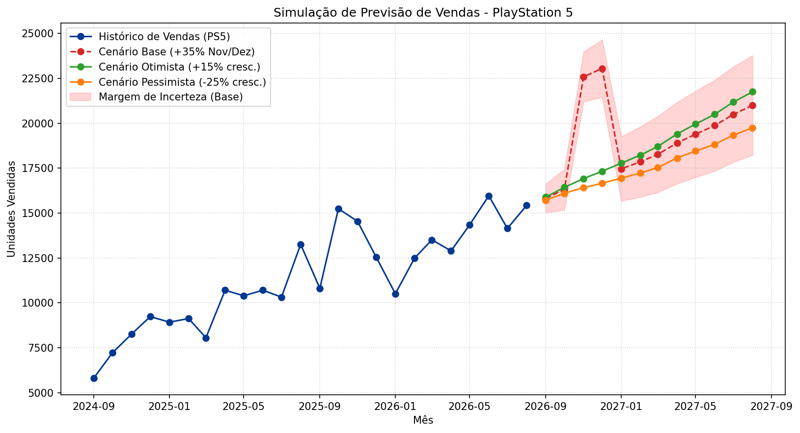

# Análise de Séries Temporais — Previsão de Vendas PlayStation 5

## 1. Contexto

Este trabalho parte de um script-base em Python (`vendas.py`) fornecido pelo
professor, que simula uma previsão de vendas do PlayStation 5 usando uma lógica
simplificada inspirada em ARIMA (tendência + uma pequena variação aleatória a
cada mês). A ideia não é rodar um ARIMA estatístico "de verdade", e sim entender
o comportamento de uma série temporal aplicando quatro modificações propostas.

O objetivo do trabalho é justamente aplicar esses quatro desafios em cima do
script original, sem trocar o modelo por outra biblioteca.

## 2. Objetivos

- Realizar uma análise de sensibilidade e volatilidade da série;
- Ampliar o horizonte de previsão;
- Incorporar a sazonalidade de Novembro e Dezembro (Black Friday e Natal);
- Comparar diferentes cenários de previsão em um único gráfico.

## 3. Tecnologias utilizadas

- Python
- NumPy
- Pandas
- Matplotlib

(São exatamente as bibliotecas que aparecem no `vendas.py`.)

## 4. Desafio 1 — Sensibilidade e Volatilidade

- A `seed` foi alterada de `42` para `6409`.
- O `6409` corresponde aos quatro últimos dígitos da matrícula.
- O desvio-padrão do ruído histórico foi alterado de `600` para `1500`.
- Aumentar esse desvio-padrão aumenta a volatilidade da série histórica: os
  pontos passam a variar mais em torno da tendência.
- O crescimento médio é calculado com `np.diff(...).mean()`, ou seja, a média
  das diferenças mês a mês.
- Na execução, o crescimento médio obtido foi de aproximadamente
  **417,59 unidades/mês**.

Um ponto importante: aumentar o ruído **não** significa que a tendência esperada
mudou. A média das diferenças tem comportamento telescópico e, em expectativa,
continua ligada à diferença entre o primeiro e o último ponto da série. O que
muda é a variabilidade da realização observada — como os pontos extremos também
passam a carregar um ruído maior, o valor concreto do crescimento médio fica
mais sensível ao sorteio aleatório e à seed usada.

## 5. Desafio 2 — Expansão do Horizonte Temporal

- A previsão foi ampliada de `6` para `12` meses.
- O período projetado vai de **setembro de 2026 (09/2026) a agosto de 2027
  (08/2027)**.
- A margem de erro foi mantida conforme a lógica original:

  ```
  margem_erro = 800 * sqrt(i)
  ```

- Como a margem depende de `sqrt(i)`, ela cresce conforme o horizonte avança:
  quanto mais longe no futuro, maior a incerteza acumulada.

## 6. Desafio 3 — Sazonalidade

- Novembro e Dezembro recebem um aumento fixo de **35%** na previsão do mês.
- A identificação do mês é feita pela propriedade `.month` da data.
- No horizonte projetado, **Novembro/2026 e Dezembro/2026** recebem esse aumento.
- **Janeiro/2027 não herda** o aumento.
- A sazonalidade foi aplicada de forma pontual: ela afeta apenas o valor previsto
  daquele mês específico, sem alterar a trajetória estrutural de crescimento dos
  meses seguintes. Por isso o valor "extra" de Novembro/Dezembro não se propaga
  para Janeiro.

## 7. Desafio 4 — Cenários e Gráfico

O gráfico final reúne o histórico e três cenários de previsão.

### Histórico

Linha azul com marcadores.

### Cenário Base

Linha vermelha tracejada. Usa o horizonte de 12 meses e a regra sazonal dos
Desafios 2 e 3 (o +35% de Novembro/Dezembro).

### Cenário Otimista

Linha verde. Usa o crescimento médio multiplicado por **1,15** (15% acima).

### Cenário Pessimista

Linha laranja. Usa o crescimento médio multiplicado por **0,75** (25% abaixo).

### Margem de Incerteza

Área sombreada feita com `fill_between`, aplicada **somente ao Cenário Base**
(previsão base ± margem de erro).

Os três cenários reutilizam a **mesma sequência de ruídos de projeção**. Isso
torna a comparação mais controlada: a diferença entre eles fica ligada
principalmente à taxa de crescimento, e não a sorteios aleatórios diferentes.

## 8. Resultados

- Crescimento médio: **417,59 unidades/mês**;
- Histórico: **24 meses**;
- Previsão: **12 meses**;
- Início da previsão: **09/2026**;
- Fim da previsão: **08/2027**;
- Meses com +35%: **11/2026 e 12/2026**.

## 9. Gráfico



## 10. Estrutura do projeto

```
Eng-de-Dados-e-MLOPs-MK/
├── vendas.py
├── README.md
└── evidencias/
    └── grafico_previsao_ps5.png
```

## 11. Conclusão

A atividade permitiu observar, na prática, como alterações na volatilidade do
histórico, na extensão do horizonte temporal e na aplicação de uma regra sazonal
interferem em uma projeção de séries temporais. Além disso, comparar os cenários
base, otimista e pessimista em um mesmo gráfico ajudou a visualizar como
diferentes hipóteses de crescimento afetam a previsão ao longo do tempo.
